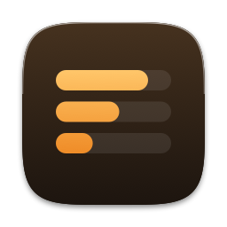

<h1 align="center">Claude Usage Meter</h1>

Your Claude usage limits, at a glance in the Mac menu bar. 
<a href="https://github.com/victor-shammas/claude-usage-meter/releases/latest/download/ClaudeUsageMeter.dmg"><b>Download for Mac</b></a> · <a href="https://victorshammas.com/claude-usage-meter/">Website</a> · Free

This repository holds the website (`docs/`, served at https://victorshammas.com/claude-usage-meter/) and the
releases: the notarized app and the update feed that installed copies check. The app's source code is kept
privately.

Questions and problems: see [Support](https://victorshammas.com/claude-usage-meter/support.html).
